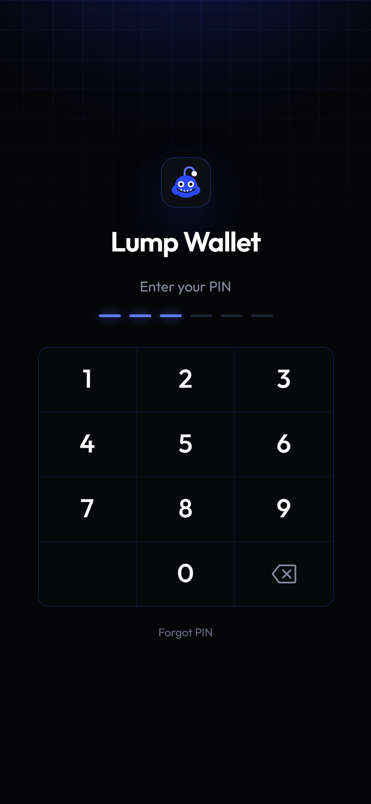
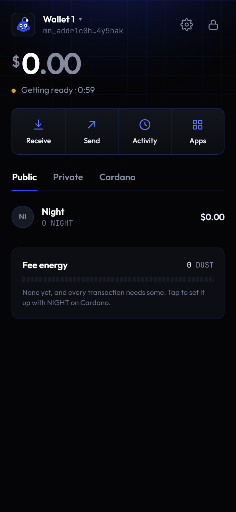
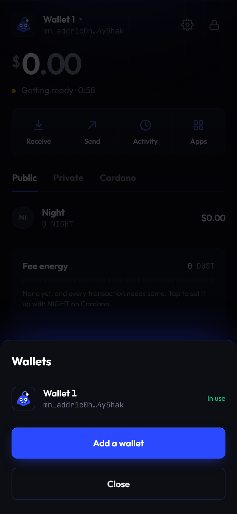
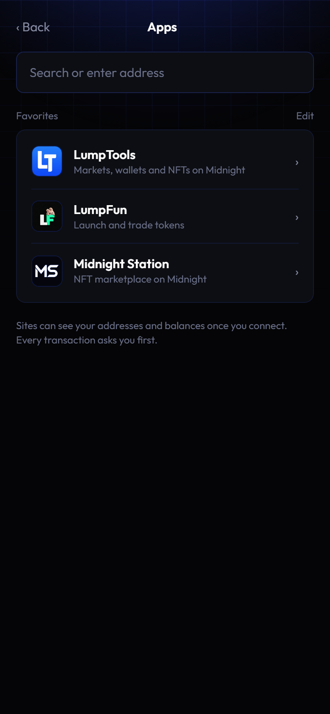
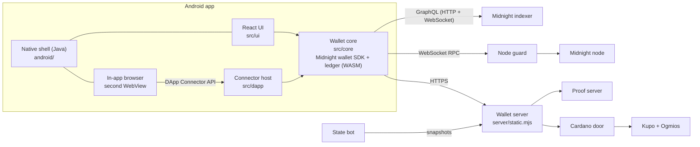

# Lump Wallet for Android

A mobile wallet for the [Midnight](https://midnight.network) network, with the Cardano side that Midnight's fee
model needs built in. The app is a web application (React, TypeScript, the official Midnight wallet SDK compiled to
WebAssembly) inside a thin native Android shell.

> **Status: public beta on mainnet. Not audited.** The wallet handles real funds and has had no independent
> security audit. Read [the security model](docs/SECURITY.md) before you trust it with anything you cannot afford
> to lose. Feedback and review are the reason this repository is public: see [Contributing](CONTRIBUTING.md).

<table>
  <tr>
    <td></td>
    <td></td>
    <td></td>
    <td></td>
  </tr>
</table>

## What it does

- **Public and private balances in one wallet.** Unshielded and shielded tokens side by side, with one switch
  between them. Send, receive (text and QR), scan an address with the camera.
- **Fee energy made understandable.** Midnight fees are paid in DUST, which is generated by NIGHT held on Cardano.
  The wallet shows DUST as a charge bar and walks a new user through getting some.
- **A Cardano address from the same 24 words.** The wallet derives a standard Cardano account (CIP-1852) from its
  recovery phrase, shows what is on it, sends and receives ADA and NIGHT, and registers the address for DUST
  generation from inside the app. Every Cardano transaction is checked byte by byte on the device before it is
  signed.
- **Several wallets on one device.** Create or import any number, switch between them from the home screen. One
  PIN for all of them.
- **An in-app browser with the Midnight DApp Connector (API 4).** Sites connect, read balances, and ask for
  transactions; every transaction is shown on an approval sheet first. Favorites and recent sites are kept on the
  device.
- **NFTs.** Single-unit tokens are matched to the contract that issued them, with collection names, pictures and a
  gallery. An NFT you hold can be the wallet's picture.
- **A first sync that takes about a minute, not an hour.** A new wallet starts from a public snapshot of the
  chain's state instead of replaying the chain. See [Architecture](docs/ARCHITECTURE.md#sync).
- **Sync that continues in the background** while the app is left (an Android foreground service with a
  notification), and **device hand-off**: a computer that has finished syncing can pass its progress to the phone,
  end-to-end encrypted with a key derived from the recovery phrase.
- **PIN, auto-lock, wait times after wrong PINs, and a confirmation before every send.**
- **Updates without a store.** The app is distributed as a signed APK and asks its server whether a newer build
  has been published.

## How it is put together



The app does not talk to a company API. It talks to a Midnight node, a Midnight indexer, a proof server, and a small
"wallet server" that is in this repository (`server/`). **A build is tied to one deployment of those services, named
at build time.** This repository does not contain the address of any server: to build a working app you point it at
services you run, or at ones whose operator has agreed to that. See [Self-hosting](docs/SELF-HOSTING.md).

## Documentation

| | |
| --- | --- |
| [Architecture](docs/ARCHITECTURE.md) | The parts of the app, how sync works, keys and storage, the Cardano side, the native shell |
| [Security model](docs/SECURITY.md) | What is protected by what, what each server learns, known limits |
| [Self-hosting](docs/SELF-HOSTING.md) | The services a build needs, how to run them, every setting |
| [Building](docs/BUILDING.md) | Development setup, debug and release APKs, signing, publishing an update, tests |
| [dApp connector](docs/DAPP-CONNECTOR.md) | For site developers: how the wallet appears to a page and what it implements |
| [Contributing](CONTRIBUTING.md) | How to report a problem, propose a change, or review the code |
| [Reporting a vulnerability](SECURITY.md) | Private reporting |

## Quick start

Requirements: Node 24, JDK 21, the Android SDK (platform 36, build-tools 36.0.0), and a deployment of the services
(see [Self-hosting](docs/SELF-HOSTING.md)).

```bash
npm ci
```

```bash
cp .env.example .env.production.local   # then name your wallet server in it
```

```bash
npm run build && npx cap sync android
```

```bash
cd android && ./gradlew assembleDebug
```

The debug APK is `android/app/build/outputs/apk/debug/app-debug.apk`. For day-to-day work the same code runs in a
desktop browser with `npm run dev`. Details, release signing and the update channel are in
[Building](docs/BUILDING.md).

## Repository layout

| Path | Contents |
| --- | --- |
| `src/core/` | Keys and the encrypted vault, the wallet session (SDK), sync cache, snapshots, hand-off, send, NFTs, the Cardano account and its transaction checks |
| `src/dapp/` | The DApp Connector: the object injected into pages (`provider.js`), the wallet side (`host.ts`), approval and logging |
| `src/ui/` | Screens: onboarding, unlock, home, send, receive, activity, apps, NFTs, fee energy, settings |
| `android/` | The native shell: in-app browser, back button and clipboard, background sync service |
| `server/` | The services a deployment runs: wallet server, node guard, state bot, Cardano door |
| `tools/` | Release build, publishing a build to the update channel, one-off snapshot jobs |
| `test/` | Self-contained tests, and the on-device suite in `test/android/` |
| `docs/` | This documentation |

## License

[Apache-2.0](LICENSE). "Lump Wallet", the angler mark ([docs/brand](docs/brand)) and the app icons are the project's names and marks: a
fork that is distributed to others should carry its own name, icon and application id
(see [Building](docs/BUILDING.md#making-it-your-own)).
