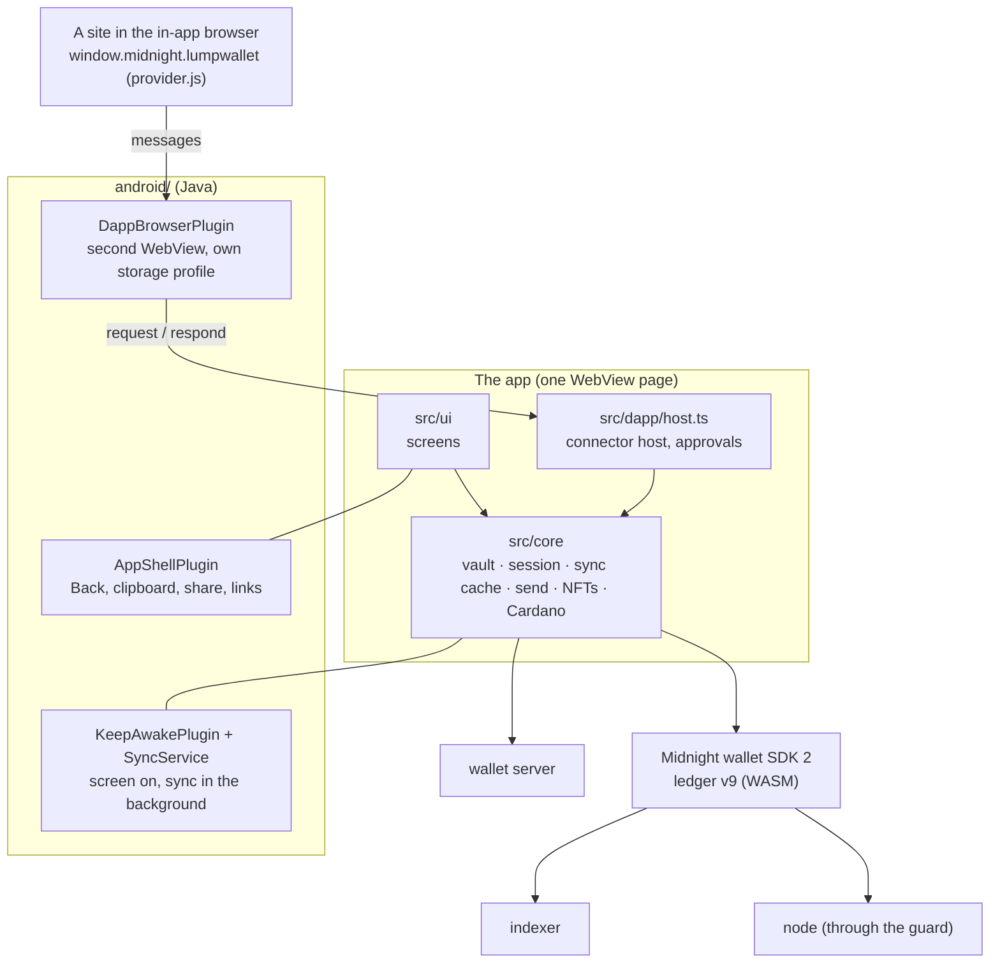
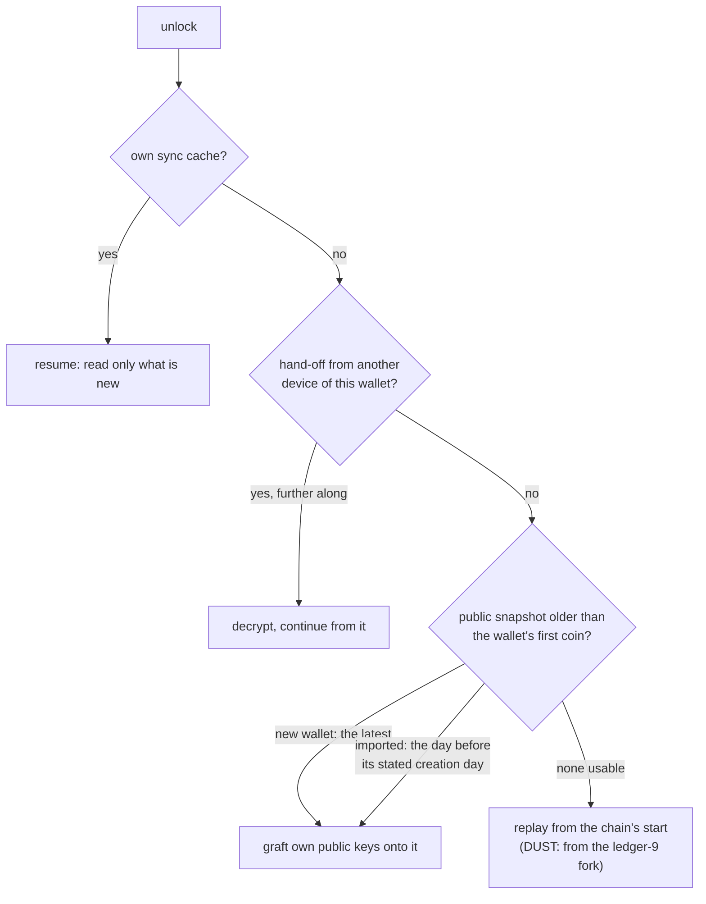
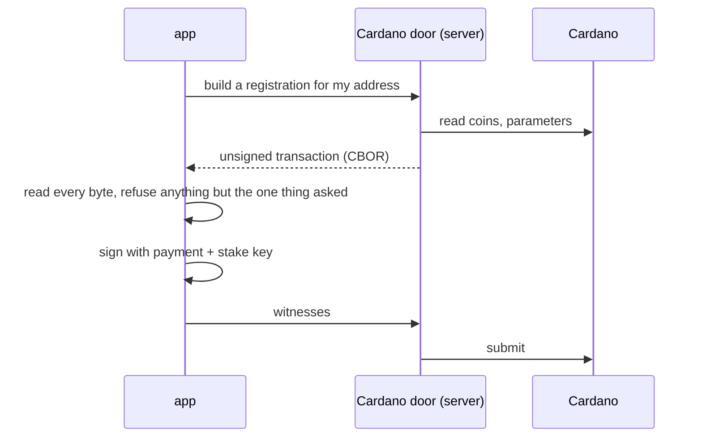

# Architecture

How Lump Wallet is built and why. For what is protected by what, see the [security model](SECURITY.md); for the
services behind the app, see [Self-hosting](SELF-HOSTING.md).

- [Overview](#overview)
- [The wallet core](#the-wallet-core)
- [Keys and storage](#keys-and-storage)
- [Sync](#sync)
- [Sending](#sending)
- [Proving](#proving)
- [The dApp browser](#the-dapp-browser)
- [NFTs](#nfts)
- [The Cardano side and fee energy](#the-cardano-side-and-fee-energy)
- [The native shell](#the-native-shell)
- [Updates](#updates)

## Overview

The wallet is one web application that runs in three places from the same source: a desktop browser (development and
tests), a served web build, and the Android app, where it runs in the system WebView inside a
[Capacitor](https://capacitorjs.com) shell. This repository holds the web code and the Android shell. The same web
code also runs in an iOS shell that is not part of this repository, which is why some source comments mention it.

Everything that touches keys, balances or transactions is TypeScript in `src/core` and `src/dapp`, on top of the
official `@midnightntwrk/wallet-sdk`. The native code holds no wallet logic: it provides the things a web page
cannot do by itself.

## The wallet core

`src/core/wallet.ts` owns a **session**: one unlocked wallet, its SDK facade (a shielded, an unshielded and a DUST
sub-wallet started from one seed), and a snapshot of its state that the UI draws once a second. The session also
decides how a wallet starts (from its own cache, from a hand-off, from a public snapshot, or from the chain's
start), saves the encrypted sync cache, builds and sends transactions, and serves the connector host.

| Module | Job |
| --- | --- |
| `keys.ts` | Recovery phrase to the three Midnight role seeds |
| `vault.ts`, `device.ts`, `attempts.ts`, `lock.ts` | The encrypted phrases, the device key, PIN wait times, auto-lock settings |
| `scope.ts` | Which stored item belongs to which of the device's wallets |
| `stateStore.ts` | The encrypted sync cache (IndexedDB) |
| `bootstrap.ts`, `dustNotes.ts` | Starting from a public snapshot; notes on where the fee energy side must start |
| `handoff.ts` | Passing sync progress between a person's own devices |
| `send.ts`, `split.ts`, `sendWait.ts` | Address parsing, sends that need several transactions, knowing when a send has landed |
| `prover.ts` | The one path to the proof server |
| `nfts.ts`, `avatar.ts` | Which tokens are NFTs and of which collection; the wallet's picture |
| `cardano.ts`, `cardanoTx.ts`, `energy.ts` | The Cardano account, the checks before a Cardano signature, fee energy state |
| `activity.ts`, `prices.ts`, `tokens.ts` | History of the public address, prices, token names |
| `net.ts` | Endpoints |
| `update.ts` | The update check |

## Keys and storage

- **One phrase.** A wallet is 24 BIP-39 words. The Midnight keys (shielded, unshielded, DUST) are derived with the
  SDK's HD scheme, account 0. The Cardano account is derived from the same words by CIP-1852
  (`m/1852'/1815'/0'`, payment key `0/0`, stake key `2/0`), so a standard Cardano wallet restores the same address.
- **Two locks on the phrase** (`vault.ts`). The phrase is encrypted with AES-256-GCM under a key from the PIN
  (scrypt, N = 2^16), and that result again under a **device key**. On a shell with a system key store the device
  key lives there and never appears in a backup. **On Android today the shell has no key-store plugin yet**, so the
  device key is a non-extractable WebCrypto key kept by the WebView beside the data. That matters; see
  [the security model](SECURITY.md#the-recovery-phrase-at-rest).
- **Wrong PINs make the wallet wait** (`attempts.ts`), longer each time, on a clock that changing the device's time
  does not skip.
- **Auto-lock** after three minutes away or idle by default, and a PIN prompt before every send and before
  approving a site's transaction (`lock.ts`, `ui/Confirm.tsx`).
- **Several wallets** (`scope.ts`). One PIN and one device key for all; each wallet is its own encrypted phrase
  with its own cache, connected sites and site activity. Only the wallet in use syncs.
- **The sync cache** (`stateStore.ts`) is what the SDK knows after syncing: which coins are the wallet's, Merkle
  paths, offsets. It is encrypted in IndexedDB with a key derived from the PIN's scrypt output.
- **No cloud backup.** The Android manifest switches off backup and device transfer for the app's data: the
  recovery phrase is the backup.

## Sync

A Midnight wallet finds its coins by reading the chain's events with its keys. Done naively, a new wallet replays
every shielded and DUST event since the chain began: about an hour on a desktop and far longer on a phone. Most of
the design work in this wallet is about not doing that.

- **Resume.** The cache is saved every minute, when the app is hidden and at lock. After a restart the wallet reads
  only what is new.
- **Public snapshots** (`bootstrap.ts`, `server/state-bot.mjs`). The serialized state of a wallet that owns no
  coins holds only public data: Merkle tree frontiers and sync offsets. The server keeps such a wallet (random
  throwaway keys, never funded) at the chain tip and publishes its state every few minutes, plus one per day. A new
  wallet takes the latest, puts its own public keys in place of the bot's, and is up to date in about a minute. An
  imported wallet is asked roughly when it was created and takes the daily snapshot from before that day. The rule
  that keeps this safe: **a snapshot must be older than the wallet's first coin**, or that coin would be skipped.
  When no snapshot qualifies, the wallet replays the chain. Slow, never wrong.
- **Fee energy needs extra care** (`dustNotes.ts`). DUST from registered NIGHT starts arriving about half a day
  after a Cardano registration, possibly while the app is closed. A wallet whose Cardano address is registered
  therefore never jumps its DUST side to a newer snapshot, and a wallet that ends up synced with no fee energy
  while the network is generating some reads that history again by itself.
- **Hand-off** (`handoff.ts`). A device can share its sync cache with the person's other devices. The cache is
  encrypted on the device with a key derived from the recovery phrase and stored on the wallet server under an id
  derived from the same phrase; the server sees ciphertext only and keeps it for 71 hours. Receiving needs no
  setting; sharing is opt-in per device.
- **In the background** (`SyncService.java`). Android suspends a WebView it cannot see. While a sync is running and
  the app is left, a foreground service with a "Syncing" notification keeps the process and the page's timers
  alive. It ends when the sync is done, the app returns, or the app is swiped away.
- **Batch size.** SDK events are applied 64 at a time, measured as the best throughput that still leaves the event
  loop room for the node and indexer connections.
- **Indexer identity** (`net.ts`). Sync offsets are an indexer's own event ids. A cache, hand-off or snapshot made
  against one indexer deployment is never continued against another.

## Sending

`send.ts` parses the destination (a public or a private Midnight address; the transfer stays in that lane), the
session builds the transfer with the SDK, signs, proves, and submits. Three details:

- **A pre-flight cost check.** The node refuses a transaction whose validation time is too high for its size, which
  happens when a token is held in many small coins. The wallet computes the ledger's cost before sending and, when
  one transaction would be refused, plans the send as several (`split.ts`) and says so on the review screen.
- **Knowing when it landed** (`sendWait.ts`). A send ends with the node's confirmation or as soon as the wallet's
  own sync sees the transaction in a block. After 90 seconds with neither, the user is told it was sent but not
  confirmed yet, and nothing is released.
- **A PIN before every send**, unless the user has switched that off.

## Proving

Shielded transfers and contract calls need zero-knowledge proofs. The wallet does not prove on the phone: it sends
the proof inputs to a proof server through `prover.ts`, two proofs at a time. The proof server is the standard
Midnight proof server; the wallet server puts a rate-limited door in front of it.

This is the largest trust decision in the design, and the [security model](SECURITY.md#the-proof-server) spells
out what the proof server receives. Proving on the device (the SDK ships a WASM prover) is the intended direction;
on phones it is limited today by memory and time.

## The dApp browser

Sites run in a **second WebView** with its own storage profile, not in the wallet's page. `src/dapp/provider.js` is
injected at document start in the top frame and exposes the Midnight DApp Connector API as
`window.midnight.lumpwallet`. Calls travel as messages to the native plugin, which attaches the page's real origin
(as the WebView reports it, never as the page claims it) and passes them to `src/dapp/host.ts`.

- Connecting, reading balances and addresses, and every transaction go through an approval sheet in the wallet's
  own page, which a site cannot draw over or click. Approve buttons arm after a short delay.
- Answers are delivered only while the page is still on the origin that asked.
- The browser view cannot reach the wallet page's own address (`https://localhost` in the app).
- Connections are stored per origin and per wallet, and are listed in Settings.
- A site's circuit keys can be many megabytes. They cross the bridge as content-addressed pieces of 512 KB.

What is implemented is listed in [dApp connector](DAPP-CONNECTOR.md).

## NFTs

Midnight has no token registry: a token type is a commitment to its minting contract and a domain separator, so the
type alone names nothing. `nfts.ts` treats single-unit tokens as candidates and accepts a contract's claim on a
token only when one of these holds: the collection is on the wallet's own list, the wallet's own mint transaction
names the contract, or the token type provably derives from the contract under a published item-id scheme. A
contract can never rename tokens it did not issue. Contract state is read from the node. Pictures load from IPFS
gateways or inline data; other remote pictures load only on a tap.

## The Cardano side and fee energy

On mainnet, DUST is generated by NIGHT held on Cardano at an address whose stake key is registered to a Midnight
DUST address. Without that, a new Midnight wallet cannot pay a single fee. So the wallet carries a Cardano account:

- **The server builds, the phone decides** (`cardanoTx.ts`). The door has the chain data and the script machinery
  and no keys. The app parses what it receives with its own CBOR reader and signs only when the transaction can do
  nothing but the one thing the user asked for: a registration may pay only the wallet's own address and the
  mapping contract, with exactly this wallet's mapping, one authorisation token, capped fee and collateral, and no
  other field; a send pays exactly the entered amount to the entered address and returns the rest. The transaction
  id that is signed is computed on the device.
- **One registration only.** Two mappings for one stake key generate nothing, so the door refuses to build a second
  and the app holds the button for half an hour after sending one.
- **Midnight sees Cardano about half a day later**, for a registration and for every NIGHT coin that arrives after.
  The app says so instead of showing zero without explanation.

## The native shell

`android/app/src/main/java/xyz/lumptools/wallet/`:

| Class | Job |
| --- | --- |
| `MainActivity` | Capacitor activity, dark system bars |
| `DappBrowserPlugin` | The in-app browser: second WebView, document-start script, message listener with origin and main-frame check, own storage profile, localhost blocked |
| `AppShellPlugin` | System Back, clipboard read for Paste, share sheet, opening a link in the phone's browser, version info |
| `KeepAwakePlugin` | Screen stays on during a sync; starts and stops the background service |
| `SyncService` | Foreground service (type `dataSync`) with a notification and a wake lock capped at six hours |

Permissions: `INTERNET`, `CAMERA` (QR scanning, asked when the scanner first opens), and what a foreground service
needs (`FOREGROUND_SERVICE`, `FOREGROUND_SERVICE_DATA_SYNC`, `WAKE_LOCK`, `POST_NOTIFICATIONS`). The only exported
component is the launcher activity. Release builds are not debuggable and their WebViews are closed to inspection.

A shell on another platform has to provide the same plugins; the web code falls back when one is missing (no
in-app browser, the screen follows the system setting, the device key is kept by the WebView).

## Updates

The app is not in a store. At start and when it returns to the front it asks the wallet server which build is
published (`update.ts`) and compares build numbers. A newer build shows "Update available" with a link to the
download page; a publisher can also mark a build as required, which makes older copies show "Update needed". No
answer from the server never blocks anyone. Android itself only installs an update signed with the same key as the
installed app.
